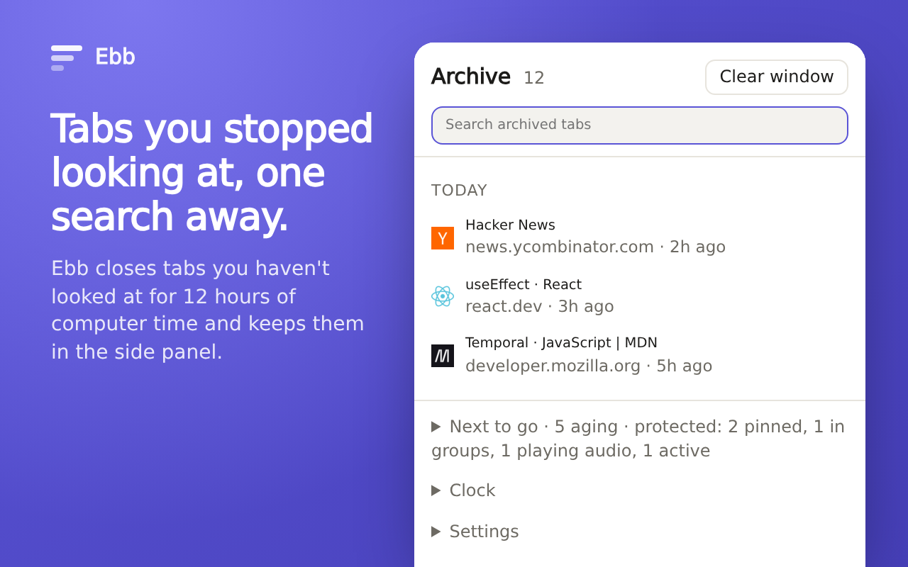

# Ebb

Ebb closes tabs you've stopped looking at and keeps them in an archive you can search, like Arc's auto-archive did. It works in Chrome, [Helium](https://helium.computer), and other Chromium browsers from version 121.



## How it decides

- A tab starts aging when you leave it. Only time at the computer counts. Sleep, a closed browser, and 10 minutes without input don't age your tabs.
- After 12 hours, Ebb closes the tab and adds it to the archive. You can pick 3 hours, 1 day, 7 days, or 30 days instead.
- Pinned tabs, tabs in a group, tabs playing audio, both panes of a split view you're looking at, and the active tab in each window are never archived. Group protection can be turned off.
- Right-click any page to keep that tab, or to never archive its site. Kept tabs stay kept across browser restarts.
- Installing Ebb doesn't archive your backlog. Tab ages start counting at install.

## Getting tabs back

- Click the toolbar icon, or press Command+Shift+E (Alt+Shift+E elsewhere), to open the archive in the side panel. Search is fuzzy: "gh eff" finds a GitHub page about Effect. ↑ and ↓ pick a result, Enter reopens it, Shift+Delete forgets it. Chips above the results narrow the list to one site.
- Or type `ebb`, then Space or Tab, in the address bar and search from there.
- A reopened tab gets its back/forward history back if it's still among the browser's 25 most recently closed tabs.
- The badge counts tabs archived since you last opened the panel.
- "Clear window" archives every unprotected tab in the window at once, like Arc's Clear, with ten seconds to undo. Tabs archived together show up together, with "Reopen all". You can bind a key to Clear window at `chrome://extensions/shortcuts`.

## Learning from you

When you keep bringing back tabs Ebb archived, the threshold is probably too short. If at least 15% of the last 20 or more tabs Ebb archived came back within a day, the panel suggests the next longer threshold. If you reopened one site three times in a week, it offers to keep that site. Ebb never changes a setting on its own, and a dismissed suggestion stays quiet.

## Install

Install Ebb from the [Chrome Web Store](https://chromewebstore.google.com/detail/ebb-auto-archive-old-tabs/jifmboaehilnoobbnfffolkhioeknlne). It works in Helium too.

From source:

```sh
bun install
bun run build
```

Then turn on Developer mode at `chrome://extensions`, choose Load unpacked, and pick `dist/`.

## Privacy

Ebb makes no network requests and has no server. The archive stays on your device. See [PRIVACY.md](PRIVACY.md).

| Permission | Why |
| --- | --- |
| `tabs` | Read the URL, title, and last-active time of tabs, close stale ones, and reopen archived ones. It doesn't grant access to page content. |
| `alarms` | Check for stale tabs once a minute. |
| `idle` | Notice when you're away, so that time doesn't age your tabs. |
| `sessions` | Reopen archived tabs with their back/forward history. |
| `sidePanel` | Show the archive next to the page. |
| `storage` | Keep the archive, away periods, and settings on your device. |
| `favicon` | Show site icons from the browser's local cache. |
| `contextMenus` | "Keep this tab" and "Never archive this site" when you right-click a page. |

## Develop

```sh
bun test        # rules, presence ledger, archive, kept tabs, suggestions
bun run check   # types
bun run zip     # dist/ and ebb.zip for the Chrome Web Store (needs zip)
```

Plain `tsc` and no bundler, since MV3 service workers load ES modules directly. The rules in `src/rules.ts` and the ledger in `src/ledger.ts` are pure functions. `src/background.ts` owns every storage write.

## Release

Bump `version` in `static/manifest.json` and push to `main`. [Kiln](https://git.schnau.dev/schnau/kiln) runs `bun run qa`, then the `release` action in `.kiln/` uploads that exact zip to the Chrome Web Store and submits it for review, publishing automatically once approved. A push whose version the store already has ends as `Unchanged`, and a newer version replaces one still waiting in review. `.kiln/decide.ts` holds that decision and `test/release.test.ts` covers it.

## License

[MIT](LICENSE)
